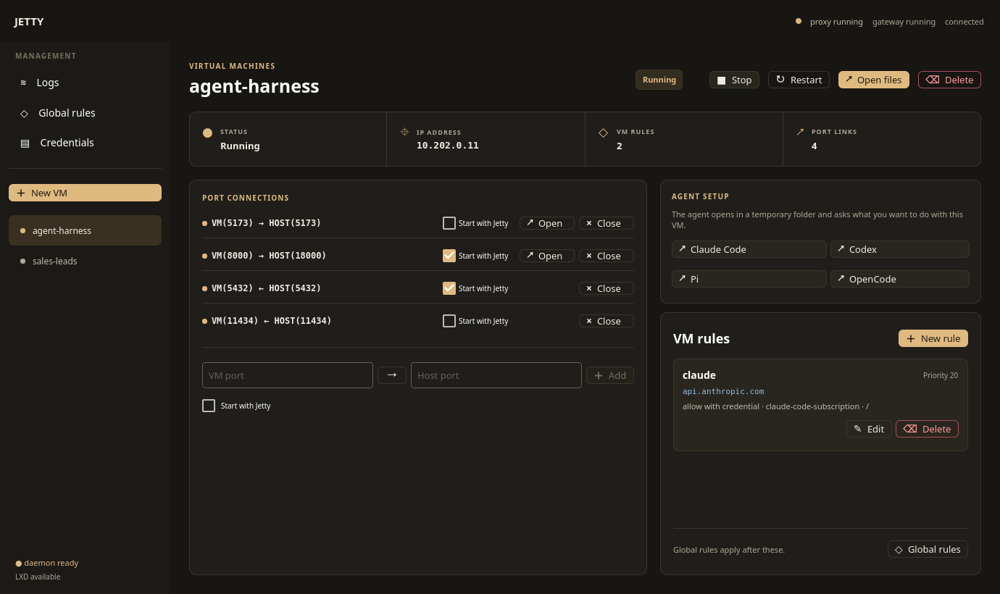

## Motivation

The current software development ecosystem just feels dangerous.

- Your agent is running bash commands in a long unsupervised session with access to all your personal files
- Each project you start immediately downloads hundreds of third-party dependencies, which execute code on your machine
- Agents are still not immune to prompt injection or to simply making a mistake (deleting your production database with that key you forgot in .env)
- Your AI credentials are very valuable targets for attacks

Also, the cost of starting a project decreased massively, but those often "pollute" you machine with random files and host config.

## How Jetty solves that

Jetty reduces the cost of creating a truly isolated environment. You can create a LXD VM for each of your project with a few clicks, then, hand off to an agent to configure it.



- The VM is isolated from your host and from your other VMs -&gt; You can let your agents run wild inside them
- The VM has access to the internet, but can't connect to other VMs or your host without an explicit SSH tunnel -&gt; You control what is exposed
- The HTTP(s) traffic is proxied -&gt; The proxy allows logging, blocking and intercepting requests
- The proxy can inject credentials to specific endpoints -&gt; Your VM does not need your GitHub or OpenAI tokens
- The VM has SSH configured -&gt; Use Orca, VSCode or JetBrains IDEs just like another SSH target

## How it works

```text
your agent → dedicated LXD VM → Jetty gateway VM (jetty-gw-agent / transparent mitmproxy)
                                    │
                                    └─(gRPC h2c on 10.201.0.1:7700 + bearer token)─▶ host jettyd
                                                                                        └─ host-held credential, only when a rule matches
```

The host daemon (`jettyd`, started via `jetty daemon`) owns all state (`state.sqlite` and `requests.sqlite`), the Interception CA, LXD lifecycle, SSH port/reverse forwards, and Credential execution. It serves one ConnectRPC/gRPC h2c protocol on `127.0.0.1:7700` (for the `jetty` CLI and `jetty-desktop`) and `10.201.0.1:7700` (exclusively for `jetty-gw` at `10.201.0.2` with a bearer token). Inside the gateway VM, `jetty-gw-agent` runs `mitmproxy` in transparent mode via local `iptables REDIRECT` and asks `jettyd` for per-connection and per-request decisions. If `jettyd`, `jetty-gw-agent`, or the gateway is down, agent VMs have no web egress at all (fail-closed).

## Use it

Download the `jetty` static Linux binary and run setup as your desktop user:

```bash
curl -fL https://github.com/cau777/jetty-vm/releases/latest/download/jetty-linux-amd64 \
  -o "$HOME/Downloads/jetty"
chmod +x "$HOME/Downloads/jetty"
"$HOME/Downloads/jetty" setup
```

Setup installs `~/.local/bin/jetty`, starts `jetty-daemon.service`, and installs the agent skill when `npx` is available. It uses `pkexec` to install and initialize snap LXD and add your account to the `lxd` group. LXD group access is equivalent to root access on the host. Sign out and back in after setup; reboot if the daemon still cannot access LXD afterward.

Use `jetty-desktop` (the Wails desktop app) or the `jetty` CLI (`jetty status`, `jetty gateway setup`, `jetty vm create`, `jetty rule put`, `jetty credential put`, `jetty log list`) to manage the gateway and agent VMs. `jetty update` installs the latest release after verifying its published SHA-256 checksum.

VMs are the default. Choose **LXD container** in the creation form or run
`jetty vm create my-container --type container` for an unprivileged container
using the same gateway and credential proxy. Containers share the host kernel.

Then ask your preferred coding agent to set up a Jetty VM for the current
project. For example:

```text
Use the orca-ssh-setup skill to provision a permission-scoped VM for this project.
I need Codex, GitHub read/write access to this repository, and the default VM size.
```

The skill first confirms the VM's name, resources, base image, required
harnesses, GitHub permissions, and any other network or secret requirements.
It then walks through the provisioned VM and the least-privilege host policy.
Interactive provider sign-ins remain on the host and are never performed by
the agent in the VM.

## Prerequisites

- Ubuntu 22.04 or newer on x86_64, with a desktop session and `snapd`.
- A Polkit authentication agent for the one-time `pkexec` prompts.
- `npx` to install the skill automatically. Without it, install
`orca-ssh-setup/` into your coding agent using that agent's skill manager.
- Codex or Claude Code on the host if you want to use those harnesses.

The proxy daemon runs as your user. LXD owns the bridges, and routing
policy lives inside the gateway VM; Jetty does not install a host firewall
rule or privileged helper.

## Project layout

- [`proto/jetty/v1/jetty.proto`](proto/jetty/v1/jetty.proto) — single ConnectRPC/gRPC protocol definition.
- [`cmd/jetty/`](cmd/jetty/) & [`internal/`](internal/) — static Go `jetty` CLI and `jettyd` central daemon (`jetty daemon`).
- [`gateway-agent/`](gateway-agent/) & [`deploy/gateway/`](deploy/gateway/) — Python transparent `mitmproxy` gateway agent and gateway iptables/systemd scripts.
- [`desktop/`](desktop/) — Wails v2 desktop app (`jetty-desktop`) sharing the generated Go ConnectRPC client.
- [`orca-ssh-setup/`](orca-ssh-setup/) — installable agent skill and end-to-end provisioning workflow.
- [`tests/`](tests/) — cross-language integration and LXD gateway e2e checks.
- [`CONTEXT.md`](CONTEXT.md) — the project's domain vocabulary.

## Development & Tests

```bash
# Regenerate Go and Python protobuf stubs
./scripts/gen-proto.sh

# Build static jetty CLI/daemon binary and run Go unit/golden/security tests
CGO_ENABLED=0 go build ./cmd/jetty
go test ./...

# Run gateway-agent tests and Go<->Python cross-language integration test
cd gateway-agent && uv run pytest -v && cd ..
gateway-agent/.venv/bin/pytest -v -c gateway-agent/pyproject.toml tests/integration/test_gateway_to_jettyd.py

# Build and test Wails desktop client
cd desktop/frontend && npm install && npm run build && cd ..
go test ./... && wails build -tags webkit2_41
```

## Security model

Jetty is designed for a trusted host operator and an untrusted coding agent
with broad authority inside its own VM. It reduces credential exposure; it is
not a general-purpose network sandbox or a substitute for reviewing the
permissions you grant in each rule. Keep rules specific to the VM, hostname,
path, and operation the agent needs.

The desktop manager is a standalone Wails application (`jetty-desktop`) talking to `jettyd` over loopback `127.0.0.1:7700`, so closing or crashing the UI never stops VM web egress.
